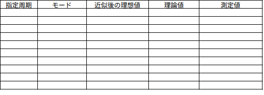

# LED 点滅実装検証報告書

作成日 2025 年 5 月 12 日
宇部工業高等専門学校 制御情報工学科 4 年 14 番
木村友亮
＿＿＿＿＿

## 1. 実験方法

<!--
「仕様書」「ソースコード」をもとに、あなたの実験結果を再現するために必要な情報を記述してください。例えば「H8とオシロの型番」「H8とオシロの接続（どこを図るか）」「オシロの設定」などは記載されていません。一方で、「H8本体と周辺機器の接続」については仕様書に明記されているため割愛して構いません。
-->

H8 実習キット K-10
デジタルオシロスコープ
DCS1054B

## 2. 機能検証（定性的検証）

### 検証結果の概要


#### 基準(引数なし)

```
prog.elf
```


```txt
xxxxxoxo
xxxxxxxx
```

ポート 0・ポート 2 がおよそ 1 秒周期で点滅

---

#### 点滅する LED パターンの指定(引数 N)

引数に-N0xee を指定(oooxooox)

```
prog.elf -N0xee
```


```txt
ooxxooox
xxxxxxxx
```

ポート 1,2,3,6,7 がおよそ 1 秒周期で点滅

---

#### 点滅周期の指定(引数 B)

引数に-B500 を指定

```
prog.elf -B500
```

```txt
xxxxxoxo
xxxxxxxx
```

ポート 0,2 が およそ 0.5 秒より短い周期で点滅

---

#### 点滅モードの指定(引数 F)

初期値 1000 は 200 の倍数であり、変化が期待できないため点滅周期 550ms(-B550) を指定する

1. 引数に-F0 を指定

   ```
   prog.elf -B550 -F0
   ```

   ```
   xxxxxoxo
   ```

   ポート 0,2 が点灯したまま消灯しない

2. 引数に-F1 を指定

   ```
   prog.elf -B550 -F1
   ```

   ```
   xxxxxoxo
   ```

   ポート 0,2 がおよそ 1 秒より短いが、0.5 秒よりは長い周期で点滅
   -B500 だけ指定したときと同じ挙動

3. 引数に-F2 を指定

   ```

   prog.elf -B550 -F2

   ```

   ```
   xxxxxoxo
   ```

   ポート 0,2 がおよそ 0.5 秒周期で点滅
   2 よりも点滅が速い

4. 引数に-F3 を指定

   ```

   prog.elf -B550 -F3

   ```

   ```
   xxxxxoxo
   ```

   ポート 0,2 がおよそ 0.5 秒よりも短い周期で点滅
   3 よりも点滅が速い

---

## 3. 非機能検証（定量的検証）

### テストケース一覧


|指定周期|モード|近似後の理想値|理論値|測定値|
|---|--|--|--|--|
|100|1|100|100|未測定|
|100|1|100|100|未測定|
|100|1|100|100|未測定|
|100|1|100|100|未測定|
|100|1|100|100|未測定|
|100|1|100|100|未測定|
|100|1|100|100|未測定|
|100|1|100|100|未測定|

### 測定波形

（オシロスコープの波形画像を以下に添付）

オシロスコープは未実行・未計測

---

## 4. 考察

- ## 機能検証で確認された問題点や特記事項

  点滅周期のズレが大きいかもしれない

- ## 非機能検証の結果からわかる傾向や特記事項

  点滅周期のズレが大きいかもしれない

- ## 理論値と測定値の差異に関する考察

  入出力のズレが重なるため、タイマーがうまく機能しない。

- ## 全体的な評価と今後の改善提案
  タイマーのカウントを回数ではなく実際の時間で計測する。
  または、デバッグをワークフローに含めずに、非同期処理として実行する。

---

## 付録：ソースコード

### main.c

@import "../src/main.c"

```c
/**
 * @file h8sample.c
 * @brief h8モーターを回転するプログラム
 * @author Yuji KATSUTA, Makoto TANABE
 * @date 2025.4.23
 */
#include "getint.h"
#include "timer.h"
#include "motor.h"
#include "led.h"
#include "nled.h"
#include "hardware_init.h"

int main(int argc, char **argv)
{
  // モーターとエンコーダーに関する変数
  int current_encoder_state;    // 現在のエンコーダーの状態
  int previous_encoder_state;   // 前回のエンコーダーの状態
  int motor_rotation_count = 0; // モーターの回転数
  int motor_on = 0;             // モーターの回転有無（0:停止、1:回転）
  // LEDに関する変数

  //===ここから===
  // int led_pattern = -1;        // LEDの点灯パターン（初期値：全点灯）
  int led_pattern = 0x05; // xxxxxoxo

  // LEDの点灯パターン
  int blink_mode = 1;
  //===ここまで

  int led_blink_period = 1000; // LEDの点滅周期（初期値：1000ms）
  // タイマーに関する変数
  int last_blink_interval = 0; // 0.5秒ごとにLEDを点滅させるためのカウンタ

  // デバッグモードに関する変数（オプション引数「-DEBUG」を読み込む）
  int debug = 0; // 初期値：デバッグモード無効

  // 引数の解析

  //===ここから===
  if (getint(argc - 1, argv + 1, "-N", &led_pattern) == 0)
  {
    printf(" N=%d ", led_pattern);
    printf(LF);
  }
  if (getint(argc - 1, argv + 1, "-F", &blink_mode) == 0)
  {
    printf(" F=%d ", blink_mode);
    printf(LF);
  }
  //===ここまで===

  if (getint(argc - 1, argv + 1, "-B", &led_blink_period) == 0)
  {
    printf(" B=%d ", led_blink_period);
    printf(LF);
  }
  if (getint(argc - 1, argv + 1, "-DEBUG", &debug) == 0 && debug)
  { // オプション引数「-DEBUG」として0以外の値が指定された
    printf("DEBUG MODE");
    printf(LF);
  }
  hardware_init();

  //===ここから===
  ledblinkmode(blink_mode);
  ledblinktime(led_blink_period);
  //===ここまで===

  init_timer0(COUNT_100MSEC, NULL);
  start_timer0();
  previous_encoder_state = motor_encoder_state();

  while (1)
  {
    if ((P5DR & 3) == 0)
    {
      break;
    } // スイッチが押されたら終了
    if ((P5DR & 1) == 0)
    {
      motor_on = 1;
    } // モーターON
    if ((P5DR & 2) == 0)
    {
      motor_on = 0;
    } // モーターOFF
    if (motor_on)
    {
      if ((P5DR & 8) == 0)
      {
        motor_fwd();
      }
      else
      {
        motor_rev();
      }
    }
    else
    {
      motor_stop();
    }
    current_encoder_state = motor_encoder_state();
    if ((previous_encoder_state == 3) && (current_encoder_state == 1))
    {
      motor_rotation_count++;
      if (motor_rotation_count > 9999)
      {
        motor_rotation_count = 0;
      }
    }
    if ((previous_encoder_state == 3) && (current_encoder_state == 2))
    {
      motor_rotation_count--;
      if (motor_rotation_count < 0)
      {
        motor_rotation_count = 9999;
      }
    }
    previous_encoder_state = current_encoder_state;
    number_led(motor_rotation_count);

    //===ここから===
    led(led_pattern);
    ledexec();
    /*
    if ((timer_get_timerv0()->count / 5) != last_blink_interval)
    {
      last_blink_interval = timer_get_timerv0()->count / 5;
      led_pattern = ~led_pattern;
      led(led_pattern);
    }
    */
    //===ここまで===

    if (debug)
    { // デバッグモードが有効のときはmcount値を標準出力する。
      printf("motor_rotation_count = %d", motor_rotation_count);
      printf(LF);
    }
  }
  motor_stop();
  stop_timer0();
  led(0);
  number_led_off();
  printf(" usage: %s [-Bxxx] [-Fy] [-Nzz] [-DEBUG1]" LF
         "   xxx: LED blink cycle [msec]" LF,
         "   y: 1:blink、0:nonblink" LF,
         "   zz: bit pattern" LF,
         "   -DEBUG1: turns on debug mode" LF,
         argv[0]);
  return 0;
}

```

### led.h

@import "../src/led.h"

```c
/**
 * @file led.h
 * @brief LEDの制御モジュール(ヘッダー)
 * @author Yuji KATSUTA, Makoto TANABE
 */

#pragma once

/**
 * @brief LED点灯関数
 * @param [in] n 2進表示する数値
 * @details
 * 詳細説明
 * - LED点灯関数
 * - bit4が使用できないので、
 * - bit4を除いた7bitで2進数表示
 */

void ledout(int n);

void led(int pat);

void ledblinkmode(int mode);

void ledblinktime(int period);

void ledexec();
```

### led.c

@import "../src/led.c"

```c
/**
 * @file led.c
 * @brief LEDの制御モジュール
 * @author Yuji KATSUTA, Makoto TANABE
 */
#include "led.h"
#include "timer.h"

#ifndef H8_H
#define H8_H
#include <stdlib.h>
#include <h8/reg3067.h>
#include <mes2.h>
#endif /* H8_H */

typedef struct
{
	int pattern;
	int period;
	int mode;

} ledv;
typedef ledv *ledvp;
static ledv _ledValue;

ledvp lv(void)
{
	return &_ledValue;
}
void ledout(int n)
{
	// bit4は使用できない、bit4以外は1で点灯
	static int oled = 0;
	if (oled != n)
	{ // 同じ場合は実行しない。
		oled = n;
		PBDR = ~(((n & 0xf0) << 1) | (n & 0x0f)); // 2022.01.26 mod
	}
	return;
}

void led(int pat)
{
	_ledValue.pattern = pat;
	return;
}

void ledblinkmode(int mode) // led_blink_mode
{
	_ledValue.mode = mode;
	return;
}

void ledblinktime(int period) // led_blink_period
{
	_ledValue.period = period;
	return;
}

void ledexec()
{
	int count = timer_get_timerv0()->count;
	int period = _ledValue.period;
	int mode = _ledValue.mode;
	int is_blinking = 0; // false
	switch (mode)
	{
	case 0:
		is_blinking = 1; // 点灯
		break;
	case 1:
		if (count / (period / 200) % 2 == 0)
			is_blinking = 1;
		break;
	case 2:
		if (count / ((period + 100) / 200) % 2 == 0)
			is_blinking = 1;
		break;
	case 3:
		if (((count * 200) / period) % 2 == 0)
			is_blinking = 1;
		break;
	default:
		is_blinking = 1;
		break;
	}
	if (is_blinking)
		ledout(_ledValue.pattern);
	else
		ledout(0);
}

```

244.6
切り捨て
244

8162/20M -> 1 カウント
