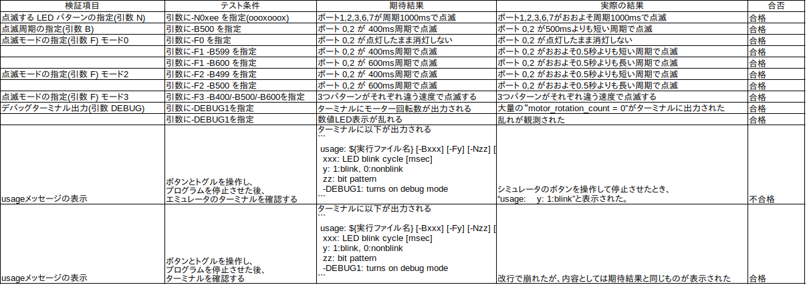
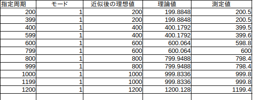
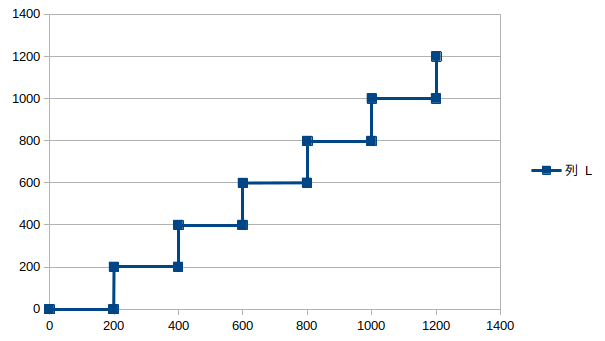
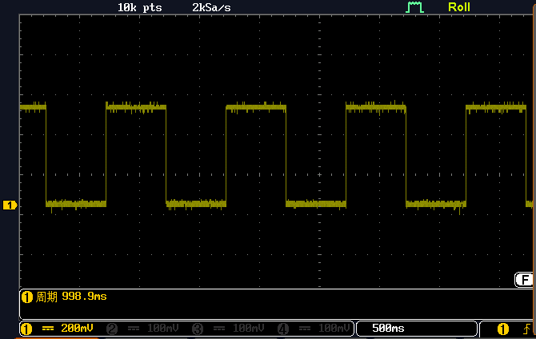

# LED 点滅実装検証報告書

作成日 2026 年 6 月 22 日
宇部工業高等専門学校 制御情報工学科 4 年 14 番
木村友亮

## 1. 実験方法

<!--
「仕様書」「ソースコード」をもとに、あなたの実験結果を再現するために必要な情報を記述してください。例えば「H8とオシロの型番」「H8とオシロの接続（どこを図るか）」「オシロの設定」などは記載されていません。一方で、「H8本体と周辺機器の接続」については仕様書に明記されているため割愛して構いません。
-->

以下を使用し、機能検証/非機能検証を行う

- H8 実習キット(H8/3069F)
- デジタルオシロスコープ DCS1054B
- H8 実習キットエミュレータ

オシロスコープは ポート 4 からつながる LED に接続し、波形を観察する。
オシロスコープの自動測定機能を使用し、複数の波形が表示されている状態での周期(平均値)を測定結果として用いる。

## 2. 機能検証（定性的検証）

### 検証項目

- コマンドライン引数 `-B`、`-N`、`-F`、`-DEBUG1` が正しく動作すること。
- 指定した点灯パターン（ビットマスク）が正しく反映されること。
- 指定した点滅モード（0 ～ 3）がそれぞれ仕様通りの挙動を示すこと。
- usage メッセージが仕様通りに表示されること。
- デバッグモード有効時の挙動。
- LED 機能の変更がモータなどの他機能に影響を与えないこと。

### 検証方法

- 各オプションを個別および組み合わせてプログラムを実行し、挙動を目視で確認する。
- コマンドラインから入力した引数とプログラムが表示する実行時オプション表示が一致することを確認する。
- デバッグモードをオンにした場合の数値 LED 表示の挙動を確認する。
- モータ制御など LED 以外の機能について、変更前（仕様 V0）と挙動が変わらないことを確認する。

### 検証結果の概要

## 

### 個別の検証結果

#### 基準(引数なし)

```
prog.elf
```


```txt
xxxxxoxo
xxxxxxxx
```

ポート 0・ポート 2 がおよそ 1 秒周期で点滅

---

#### 点滅する LED パターンの指定(引数 N)

引数に-N0xee を指定(oooxooox)

```
prog.elf -N0xee
```


```txt
ooxxooox
xxxxxxxx
```

ポート 1,2,3,6,7 がおよそ 1 秒周期で点滅

---

#### 点滅周期の指定(引数 B)

引数に-B500 を指定

```
prog.elf -B500
```

```txt
xxxxxoxo
xxxxxxxx
```

ポート 0,2 が およそ 0.5 秒より短い周期で点滅

---

#### 点滅モードの指定(引数 F)

初期値 1000 は 200 の倍数であり、変化が期待できないため点滅周期 550ms(-B550) を指定する

1. 引数に-F0 を指定

   ```
   prog.elf -B550 -F0
   ```

   ```
   xxxxxoxo
   ```

   ポート 0,2 が点灯したまま消灯しない

2. 引数に-F1 を指定

   ```
   prog.elf -B550 -F1
   ```

   ```
   xxxxxoxo
   ```

   ポート 0,2 がおよそ 1 秒より短いが、0.5 秒よりは長い周期で点滅
   -B500 だけ指定したときと同じ挙動

3. 引数に-F2 を指定

   ```

   prog.elf -B550 -F2

   ```

   ```
   xxxxxoxo
   ```

   ポート 0,2 がおよそ 0.5 秒周期で点滅
   2 よりも点滅が速い

4. 引数に-F3 を指定

   ```

   prog.elf -B550 -F3

   ```

   ```
   xxxxxoxo
   ```

   ポート 0,2 がおよそ 0.5 秒よりも短い周期で点滅
   3 よりも点滅が速い

## 3. 非機能検証（定量的検証）

### 検証対象

- 点滅周期オプション `-B` で指定可能な時間間隔。
- 点滅モード `-F` による周期近似処理。

### 点滅モード

時間の関係で、点滅周期 `-F`を 1 に固定する。

### テストケース一覧



### 値の変化(モード 1 )



### 測定波形

※後日改めて撮ったもののため、測定結果は検証結果表と差がある


---

## 4. 考察

- ### 機能検証で確認された問題点や特記事項

  少なくとも今回検証に使用したエミュレータとターミナルでは print 出力が不安定で、改行やスペースなどの処理はきれいに表示されない場合が多い

- ### 非機能検証の結果からわかる傾向や特記事項

  理論値/理想値と実測値は概ね一致している。
  指定周期そのものとの差は境界付近で大きくなる一方で、理論値との差は小さい。

- ### 理論値と測定値の差異に関する考察

  実測値と理論値の差は最大で約 1.3 ms であった。この差については、メインループでの出力更新タイミング、実習キットのクロック精度、オシロスコープの自動測定のばらつきなどが影響した可能性がある。ただし、今回の測定回数だけでは原因を特定できないため、各条件について複数回測定し、比較する必要がある。

- ### 全体的な評価と今後の改善提案

  概ね期待通りに動作した。
  改善が可能な点としては、機能検証をエミュレータのみで行い、LED 以外部分のモータ・7 セグなどの挙動については確認できていない点である。時間があればさらに検証項目を追加し、コードと照らし合わせて全体の機能を検証するべきだと考えられる。

---

## 付録：ソースコード

### main.c

@import "../srcV1/main.c"

### led.h

@import "../srcV1/led.h"

### led.c

@import "../srcV1/led.c"
