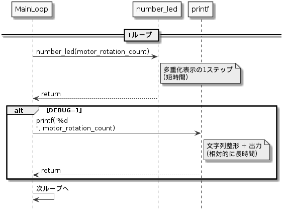

# review01（V0 ふりかえり：質問への解説案）

このメモは、各グループから出た不明点を**観点ごと**にまとめ、授業内で返しやすいようにした解説案です。  
対象は主に `1st/srcV0` と `1st/specV0.html` の内容です。

> 前提：学生は実習ディレクトリ直下で `1st/` と `doc/` を並べて配置している。  
> そのため、本ファイルから `doc/` への参照は `../doc/...` の相対パスで記載する。

---

## 1. 実行時引数・`main(argc, argv)`・`getint`まわり

### 学生から出た質問（まとめ）

- `main` の引数 `argc`, `argv` は何か。
- `main.c` 30 行目の `getint(argc - 1, argv + 1, "-B", &led_blink_period)` の引数はどこから来るのか。
- `prog.elf [-Bxxx] [-DEBUG1]` の「`[]`あり/なし」の違いは何か。
- `getint` は何をして何を返しているか。
- `getint.c` の `ret=KATCOMP;` は何を意味するか。

### 解説

- `int main(int argc, char **argv)` は、**コマンドライン引数を受け取る C の標準的な形**です。
  - `argc`: 引数の個数
  - `argv`: 引数文字列配列（`argv[0]` は通常プログラム名）
- 例: `prog.elf -B500 -DEBUG1` で実行した場合、`argv` のイメージはおおよそ以下です。
  - `argv[0] = "prog.elf"`
  - `argv[1] = "-B500"`
  - `argv[2] = "-DEBUG1"`
- `getint(argc - 1, argv + 1, "-B", &led_blink_period)` は、`argv[0]`（プログラム名）を除いた引数だけを見て、`-B` に続く整数値を探して `led_blink_period` に格納します。
- `[]` は仕様書上の記法で「**省略可能**」を意味します。実際に入力する文字ではありません。  
  つまり、`[-Bxxx]` は「`-Bxxx` を付けてもよい／付けなくてもよい」という意味です。
- `getint` の返り値は `KATCOMP`（成功）か `KATERR`（失敗）で、ヘッダでは `KATCOMP=0`, `KATERR=1` と定義されています。`ret=KATCOMP;` は「見つかって整数変換もできたので成功にする」という意味です。
- `s2int` は文字列を 10 進/16 進(`0x...`)/2 進(`0b...`)として整数化する処理を持っており、ここが「文字がある間処理し続ける」ように見える部分です。

### 参照資料（doc）

- `main(argc, argv)` と `getint` の動作を実際に確認する最短資料：
  - [../doc/test_getint/main.c](../doc/test_getint/main.c)
  - [../doc/test_getint/getint.h](../doc/test_getint/getint.h)
  - [../doc/test_getint/getint.c](../doc/test_getint/getint.c)
  - [../doc/test_getint/test_getint.pdf](../doc/test_getint/test_getint.pdf)
- `main` 引数の基礎説明：
  - [../doc/C 言語の知識/main 関数の引数\_1.pdf](../doc/C言語の知識/main関数の引数_1.pdf)
  - [../doc/C 言語の知識/main 関数の引数\_2.pdf](../doc/C言語の知識/main関数の引数_2.pdf)

---

## 2. `getint.h` のマクロ・プリプロセッサ記法（`#ifdef`, include guard など）

### 学生から出た質問（まとめ）

- `KATOWN` の意味。
- `@` に続く文字の意味（※Doxygen コメントの記法と思われる）。
- インクルードガードとは何か。
- `#endif` とは何か。

### 解説

- `KATOWN` は、このヘッダ内で `debgnflag` を **extern 宣言にするか実体定義にするか** を切り替えるためのマクロです。  
  `getint.c` では `#define KATOWN` してから `getint.h` を読み込むため、`debgnflag` の実体が 1 回だけ作られる設計です。
- `@brief`, `@param`, `@retval` などは **Doxygen 用タグ**です（質問文の「@」はこのことの可能性が高い）。C 言語構文ではなく、ドキュメント生成用の注釈です。
- インクルードガードは、同じヘッダが複数回 `#include` されても再定義エラーを防ぐ仕組みです。  
  例: `#ifndef H8_H` / `#define H8_H` / `...` / `#endif`
- `#endif` は `#if` / `#ifdef` / `#ifndef` の条件分岐を閉じるためのプリプロセッサ命令です。

### 参照資料（doc）

- `KATOWN`・`#ifdef`・`#endif` の実例：
  - [../doc/test_getint/getint.h](../doc/test_getint/getint.h)
- Doxygen タグ（`@brief` など）の実例：
  - [../doc/test_getint/getint.h](../doc/test_getint/getint.h)

---

## 3. `motor.c`（16〜27 行付近）構造体・状態管理・PWM 関連

### 学生から出た質問（まとめ）

- `motor.c` 16〜27 行の意味と必要性。
- 構造体がわからない。
- 35/46/57 行の `mflag`（PWM 関連っぽい操作）がわからない。

### 解説

- 16〜21 行では、モータ制御の内部状態をまとめる構造体 `motorc` を定義しています。
  - `cnt`: 直近で出力した制御値（どの状態を出したか）
  - `mflag`: PWM やモータ状態管理に使うフラグ（V0 では将来拡張の痕跡を含む）
- `static motorc mcv;` で**モジュール内だけで使う状態変数**を 1 個持ちます。
- `mc()` は `mcv` へのポインタを返すアクセサ形式ですが、V0 では実質あまり使われていません（設計上の統一のために残っている形）。
- `motor_fwd/rev/stop` は、同じ状態への再書き込みを避けるため `if (mcv.cnt != ... )` を置いています。不要なポート書き換えを減らす意図です。
- `mflag` のビット演算は、現在コード上で直接 PWM 周期制御まで実装しているわけではなく、**状態ビットを保持する設計名残/拡張余地**と理解するとよいです。まず授業では `PADR` に出している値（`0x18`,`0x14`,`0x10`）とモータ動作の対応を押さえるのが優先です。

---

## 4. デバッグモードと表示値（コンソール vs 7 セグ LED）

### 学生から出た質問（まとめ）

- DEBUG モードは何をするのか。
- 仕様「モータ回転数を LED 表示」と、デバッグ出力の関係がわからない。
- DEBUG 中に出る「9」「1」は何を示すのか。
- コンソール値と 7 セグ値が違うことがあるのはなぜか。
- 4 桁 LED の桁上がり時に不安定に見える。

### 解説

- V0 の DEBUG モードは、`-DEBUG1` 指定時に `debug` が非 0 となり、ループごとに `motor_rotation_count` を `printf` する機能です（追加ログ表示モード）。
- 7 セグ表示は `number_led(motor_rotation_count)` で常時更新されますが、実装は**多重化表示（1 桁ずつ高速に切替）**です。1 回の呼び出しで 4 桁同時表示ではありません。
- `nled.c` では内部カウンタ `ledc` により `j % 4` で表示桁を順に回し、最後に `ledc=(ledc+1)%(4*MOD)` で進めています。これにより瞬間を見ると「1 桁だけ点灯」「数字が揺れる」ように見えることがあります。
- コンソール表示と 7 セグ表示がずれる主因は、**表示更新タイミングの違い**です。
  - コンソール: 文字列出力（時間がかかる）
  - 7 セグ: ループ内で高速に桁切替表示
- 「9」「1」は特別なデバッグ記号ではなく、その時点で該当桁に出ている数字（回転カウントの一部）である可能性が高いです。`-DEBUG1` の `1` は「debug を ON にするための値」です。

---

## 5. 回転数カウント、方向判定、`mcount` の意味

### 学生から出た質問（まとめ）

- `mcount`（`motor_rotation_count`）とは何か。
- 正転/逆転の判定ロジックをどう読めばよいか。
- 「正転なのに減る/逆転なのに減る」ように見えることがある。

### 解説

- `motor_rotation_count` は、エンコーダ状態遷移から推定した回転カウントです。
- `motor_encoder_state()` は `PADR & 0x03` を返し、A/B 相の 2bit 状態（0〜3）を返します。
- V0 の判定は「前回 3 → 今回 1 なら加算」「前回 3 → 今回 2 なら減算」という**一部遷移だけを使う簡略判定**です。  
  そのため、サンプリングタイミングやノイズで期待通りに見えないケースが起き得ます。
- デバッグ時は `printf` が重くループ周期に影響するため、遷移取りこぼし/見え方の差が増えることがあります。

---

## 6. `timer_get_timerv0()->count` とアロー演算子

### 学生から出た質問（まとめ）

- アロー演算子 `->` の意味。
- `timer_get_timerv0()->count` が何をしているのか。

### 解説

- `timer_get_timerv0()` は `timerv` 構造体へのポインタ（`timerv*`）を返します。
- `->` は「構造体ポインタが指す先のメンバにアクセス」する演算子です。  
  `p->count` は `(*p).count` と同じ意味です。
- ここではタイマー割込みで増加する `count` を読み、`count/5` が変化したら LED 点滅状態を反転しています（約 0.5 秒ごと）。

---

## 7. ハードウェア初期化（`hardware_init`）の中身

### 学生から出た質問（まとめ）

- ハードウェア初期化は具体的に何をしているのか。

### 解説

- `hardware_init()` は各ポートの方向（入力/出力）と初期値を設定します。
  - `PADDR=0xfc`: PA0〜1 入力（エンコーダ）、PA2〜7 出力（モータ制御）
  - `PBDDR=0xff`, `PBDR=0xff`: LED ポートを出力化し初期消灯
  - `P4DDR=0xff`: 数値 LED ポートを出力化
  - `P5DDR=0xf0`: スイッチ側を入力として使う設定
- これをしないと、ポートが意図通り入出力されず、モータ・LED・スイッチが正しく動きません。

### 参照資料（doc）

- 配線確認資料は `doc/` には見当たらないため、必要なら `1st/haisen.jpg` を併読する。

---

## 8. 二重ポインタ（`char **argv`）の理解

### 学生から出た質問（まとめ）

- ポインタのポインタ（2 重ポインタ）とは何か。

### 解説

- `argv` は「文字列の配列」ですが、C では実体は「`char*`（文字列先頭アドレス）の並び」です。  
  したがって型は `char**` になります。
- 住所のたとえで言うと：
  - 文字 1 文字の住所: `char*` が持つ先
  - 文字列ポインタ（`char*`）の住所を並べた表: `char** argv`
- `argv + 1` は「配列の先頭を 1 つ進める」ので、`argv[1]` から見るのと同義です。

### 参照資料（doc）

- `argc/argv` 実測例つき資料：
  - [../doc/test_getint/main.c](../doc/test_getint/main.c)
  - [../doc/test_getint/test_getint.pdf](../doc/test_getint/test_getint.pdf)

---

## 9. シーケンス図・モジュール関連図の読み方（授業向けミニガイド）

### 学生から出た質問（まとめ）

- シーケンス図の見方がわからない。
- モジュール関連図が読めない。

### 解説

- **シーケンス図**は「時間の流れ（上 → 下）」と「誰が誰を呼ぶか」を読む図です。  
  最初は `main` の 1 ループだけ追うのがコツです。
  1. 入力読む（スイッチ/エンコーダ）
  2. モータ制御関数呼び出し
  3. 回転数更新
  4. 表示更新（number_led/printf/led）
- **モジュール関連図**は「依存関係」を見る図です。  
  `main.c` が上位で、`motor`,`nled`,`timer`,`hardware_init`,`getint` などを利用する構造として読むと理解しやすいです。

### 参照資料（doc）

- UML/PAD 参考資料一覧：
  - [../doc/UML と PAD 図/README.md](../doc/UMLとPAD図/README.md)
- 個別資料：
  - [../doc/UML と PAD 図/05\_シーケンス図.pdf](../doc/UMLとPAD図/05_シーケンス図.pdf)
  - [../doc/UML と PAD 図/03\_クラス図.pdf](../doc/UMLとPAD図/03_クラス図.pdf)
  - [../doc/UML と PAD 図/04_C 言語と UML.pdf](../doc/UMLとPAD図/04_C言語とUML.pdf)
  - [../doc/UML と PAD 図/06_1_PAD 図記事.pdf](../doc/UMLとPAD図/06_1_PAD図記事.pdf)

---

## 付録 A：`printf`実行時間と`number_led()`周期差の可視化（PlantUML ソース）



---

## 付録 B：A/B 相 4 状態遷移（正転・逆転）と V0 簡略判定の比較

### B-1. 状態遷移の基本（グレイコード巡回）

- 正転（例）：`00 -> 01 -> 11 -> 10 -> 00`
- 逆転（例）：`00 -> 10 -> 11 -> 01 -> 00`

### B-2. 遷移表（1 ステップごとの符号）

| 前回     | 今回     | 判定                      |
| -------- | -------- | ------------------------- |
| 00       | 01       | +1（正転）                |
| 01       | 11       | +1（正転）                |
| 11       | 10       | +1（正転）                |
| 10       | 00       | +1（正転）                |
| 00       | 10       | -1（逆転）                |
| 10       | 11       | -1（逆転）                |
| 11       | 01       | -1（逆転）                |
| 01       | 00       | -1（逆転）                |
| 同一状態 | 同一状態 | 0（変化なし）             |
| その他   | その他   | ノイズ/異常遷移として扱う |

### B-3. V0 簡略判定との差分（教材化ポイント）

- V0 は「`prev==3(11)` のときだけ判定する」簡略方式（`11->01` を + / `11->10` を - のような限定判定）になっており、
  **全遷移のうち一部しか使わない**。
- そのため、サンプリング周期や`printf`負荷、ノイズがあると「取りこぼし」「期待と逆に見える」現象が起きやすい。
- V1 以降の改善方針は、`(prev, curr)` の全組を遷移表で判定して、
  - 正常 4 遷移（正転）
  - 正常 4 遷移（逆転）
  - 同一遷移（0）
  - 異常遷移（無視 or エラーカウント）
    に分けること。

### B-4. タイムライン例（テキスト）

```text
時刻      t0   t1   t2   t3   t4
A/B相     00   01   11   10   00   => 正転で +4

時刻      t0   t1   t2   t3   t4
A/B相     00   10   11   01   00   => 逆転で -4

(取りこぼし例)
時刻      t0   t1   t2
A/B相     00   11   10
         ↑本来は01を通るはず
         全遷移表がない実装だと誤判定しやすい
```
