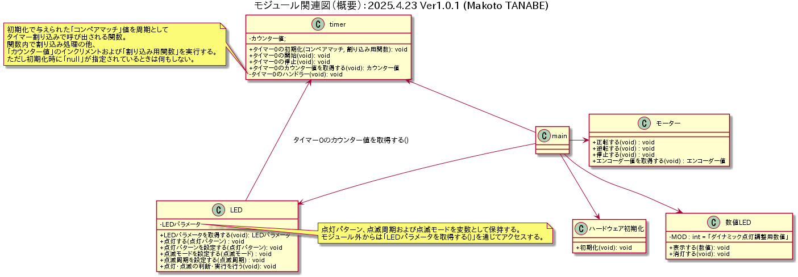
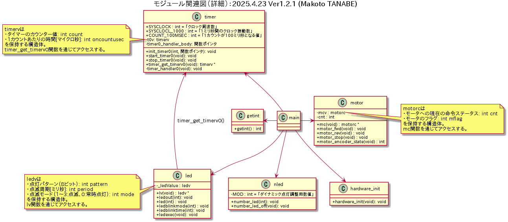
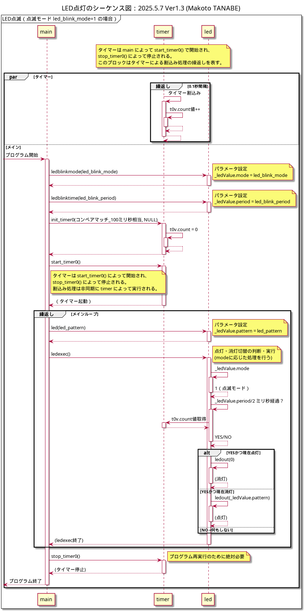
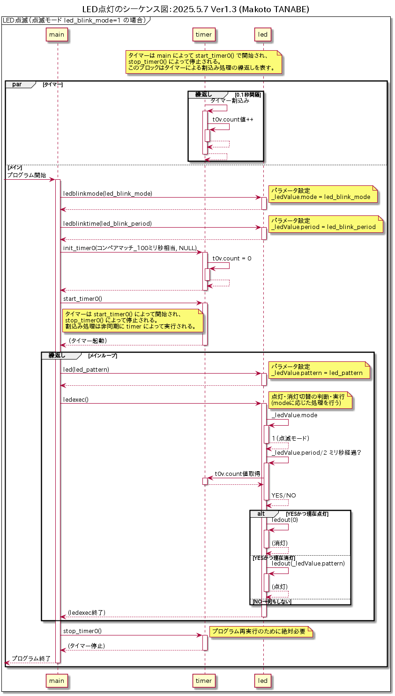

# LED 制御をタイマー割り込みで行う製品 V2 仕様書

**バージョン：Ver.2.0.0**  
**作成日：2026 年 10 月 20 日**  
**作成者：木村 友亮**

> 本仕様書は、製品 V1 の仕様を出発点として、LED の点滅判断および点灯・消灯処理を、`main`関数のメインループからタイマー割り込みへ移す製品 V2 の仕様を定める。

---

## 目次

1. [概要](#1-概要)
2. [接続](#2-接続)
3. [機能](#3-機能)
4. [V1 から V2 への変更](#4-v1からv2への変更)
5. [モジュール構成](#5-モジュール構成)
6. [PAD 図](#6-pad図)
7. [呼出し手順](#7-呼出し手順)
8. [関数仕様](#8-関数仕様)
9. [実装時の要求事項](#9-実装時の要求事項)
10. [改訂履歴](#10-改訂履歴)

---

# 1. 概要

## 1.1 製品の概要

本製品は、H8 マイコンに接続したモータ、LED、数値 LED およびスイッチを制御する。

製品 V1 では、LED の点滅判断および点灯・消灯処理を`ledexec()`が担当し、`main`関数のメインループから呼び出していた。この方式では、今後メインループ内の処理が増えた場合、LED 点滅の実行タイミングがメインループの実行周期に影響される可能性がある。

製品 V2 では、LED の点滅判断および点灯・消灯処理をタイマー割り込みから実行する。これにより、メインループの処理量に依存しない LED 点滅制御を実現する。

## 1.2 V2 の設計方針

V2 では次の変更を行う。

- `init_timer0()`の第 2 引数に`led_handler`を指定する。
- LED モジュール内に`led_handler()`を追加する。
- `led_handler()`の機能は、V1 の`ledexec()`と同等とする。
- V1 の`ledexec()`を削除する。
- 点灯パターンを設定する`led(num)`は、引き続き`main`関数のメインループ内で実行する。
- LED の点滅判断および点灯・消灯は、タイマー割り込みから呼び出される`led_handler()`が担当する。

## 1.3 V2 で変更しない事項

次の仕様は V1 から変更しない。

- マイコンと各装置の接続
- スイッチによる動作モードの切り替え
- モータの正転、逆転および停止
- エンコーダによる回転状態の取得
- 数値 LED への回転状態の表示
- 実行時引数による LED 制御パラメータの設定
- 点灯パターンの設定をアプリケーションで行う設計

---

# 2. 接続

接続仕様は V1 から変更しない。

## 2.1 モータ

- PA4 に PWM SIG 端子を接続する。
- PA3 に IN1 を接続する。
- PA2 に IN2 を接続する。
- PA1 にエンコーダ B を接続する。
- PA0 にエンコーダ A を接続する。

## 2.2 LED および数値 LED

- PB0 から PB7 に LED 端子を接続する。
- P4 に number LED 端子を接続する。

## 2.3 スイッチ

- P53 に一番手前のトグルスイッチを接続する。
- P51 に一番手前のプッシュスイッチを接続する。
- P50 に手前から二番目のプッシュスイッチを接続する。

---

# 3. 機能

## 3.1 動作モードの切り替え

- P51 のプッシュスイッチを押すと、動作モードを ON にする。
- P50 のプッシュスイッチを押すと、動作モードを OFF にする。

## 3.2 動作モードが ON のときの動作

- トグルスイッチが ON、入力値が`0`のとき、モータを正転させる。
- トグルスイッチが OFF、入力値が`1`のとき、モータを逆転させる。

## 3.3 動作モードが OFF のときの動作

- モータを停止状態にする。

## 3.4 数値 LED

エンコーダの周期に応じてモータの回転状態を数値 LED に表示する。

- 正回転時は表示値をインクリメントする。
- 逆回転時は表示値をデクリメントする。

## 3.5 LED

LED は、実行時引数として与えられた次のパラメータに基づいて動作する。

| パラメータ             | 変数     | 内容                                            |
| ---------------------- | -------- | ----------------------------------------------- |
| 点滅周期               | `blmsec` | LED の点滅に使用する時間を指定する。            |
| 点滅の有無またはモード | `bflag`  | LED を点滅させるかどうかを指定する。            |
| 点灯パターン           | `num`    | 点灯対象とする LED のビットパターンを指定する。 |

### 3.5.1 点灯パターン

`main`関数は、`led(num)`を呼び出して LED の点灯パターンを設定する。

点灯パターンの設定はアプリケーションが担当する。現在は初期化後に`num`の値を変更しないが、今後、アプリケーションの実行状態を LED パターンで表示できるようにするため、`led(num)`はメインループ内に残す。

### 3.5.2 点滅判断および点灯・消灯

LED の点滅判断および点灯・消灯は、LED モジュールの`led_handler()`が担当する。

`led_handler()`は`main`関数から直接呼び出さず、タイマー 0 の割り込み処理から周期的に呼び出す。

### 3.5.3 既定の点滅動作

既定の LED 動作では、次の動作を繰り返す。

- 約 0.5 秒間点灯する。
- 約 0.5 秒間消灯する。
- 点灯開始から次の点灯開始までを約 1 秒とする。

### 3.5.4 実行時引数と LED 動作の関係

`main`関数は、実行時引数から`blmsec`、`bflag`および`num`を読み取る。

読み取った値は次の関数によって LED モジュールへ設定する。

```c
ledbflag(bflag);       /* 点滅の有無またはモードの設定 */
ledblinktime(blmsec);  /* 点滅周期の設定 */
led(num);              /* 点灯パターンの設定 */
```

`led_handler()`は、これらの設定値に基づいて点滅判断および点灯・消灯を行う。

> `blmsec`および`bflag`の有効範囲と各値の厳密な動作は、V1 仕様を引き継ぐ。V2 では、それらの設定方法を変更せず、処理の呼出し元だけをメインループからタイマー割り込みへ変更する。

---

# 4. V1 から V2 への変更

## 4.1 変更前の V1

V1 では、`main`関数のメインループから`ledexec()`を呼び出していた。

```c
int main(int argc, char **argv)
{
    /* 実行時引数の読み取り
       周期：blmsec
       モード：bflag
       パターン：num */

    ledbflag(bflag);
    ledblinktime(blmsec);

    init_timer0(COUNT_100MSEC, NULL);
    start_timer0();

    while (1) {
        led(num);
        ledexec();

        /* LED以外の処理 */
    }
}
```

## 4.2 変更後の V2

V2 では、`init_timer0()`の第 2 引数に`led_handler`を渡す。メインループから`ledexec()`を削除し、LED の点滅判断および点灯・消灯をタイマー割り込み側へ移す。

```c
int main(int argc, char **argv)
{
    /* 実行時引数の読み取り
       周期：blmsec
       モード：bflag
       パターン：num */

    ledbflag(bflag);
    ledblinktime(blmsec);

    init_timer0(COUNT_100MSEC, led_handler);
    start_timer0();

    while (1) {
        led(num);

        /*
         * ledexec()は呼び出さない。
         * 点滅判断および点灯・消灯は、タイマー割り込みから
         * 呼び出されるled_handler()が担当する。
         */

        /* LED以外の処理 */
    }
}
```

## 4.3 変更内容の比較

| 項目                       | V1                             | V2                        |
| -------------------------- | ------------------------------ | ------------------------- |
| 点灯パターン設定           | `main`から`led(num)`を呼び出す | 変更なし                  |
| 点滅判断                   | `ledexec()`                    | `led_handler()`           |
| 点灯・消灯処理             | `ledexec()`                    | `led_handler()`           |
| LED 周期処理の呼出し元     | `main`のメインループ           | タイマー 0 の割り込み処理 |
| `init_timer0()`の第 2 引数 | `NULL`                         | `led_handler`             |
| `ledexec()`                | 使用する                       | 削除する                  |

## 4.4 タイマー割り込みの仕組み

タイマーモジュールは、`init_timer0()`の第 2 引数として受け取った関数ポインタを`timer0_handler_body`へ保存する。

```c
static void (*timer0_handler_body)(void);

void init_timer0(int compare, void (*timer_handler_body)(void))
{
    timer0_handler_body = timer_handler_body;
    /* タイマー初期化処理 */
    set_handler(36, timer0_handler);
}
```

8 ビットタイマー 0 のコンペアマッチ A イベントが発生すると、`timer0_handler()`が呼び出される。

```c
#pragma interrupt
static void timer0_handler(void)
{
    load_segment(36);
    t0v.count++;

    if (timer0_handler_body != NULL) {
        (*timer0_handler_body)();
    }

    TCSR0_8 &= ~0x40;
    return;
}
```

V2 では次の初期化を行うため、`timer0_handler_body`は`led_handler`を指す。

```c
init_timer0(COUNT_100MSEC, led_handler);
```

したがって、LED 制御の呼出し順序は次のようになる。

```text
8ビットタイマー0のコンペアマッチAイベント
    ↓
timer0_handler()
    ↓
timer0_handler_bodyがNULLでないことを確認
    ↓
led_handler()
    ↓
点滅判断およびLEDの点灯・消灯
```

---

# 5. モジュール構成

V2 のモジュール関連図を以下に示す。

V1 からの主な変更は、`main`モジュールから`ledexec()`を呼び出す関係を削除し、タイマーモジュールから LED モジュールの`led_handler()`を呼び出す関係を追加することである。

モジュール関連図のコメントには、実装者が次の内容を理解できるように記載する。

- `main`は`led(num)`で点灯パターンを設定する。
- `main`はタイマー 0 の初期化時に`led_handler`を登録する。
- タイマーモジュールはコンペアマッチ A イベント時に`led_handler()`を呼び出す。
- LED モジュールは点滅判断および LED 出力を行う。
- `ledexec()`は V2 では使用しない。

## 5.1 概要モジュール関連図



## 5.2 詳細モジュール関連図



---

# 6. PAD 図

V2 の PAD 図は、V1 の PAD 図を出発点として変更する。

PAD 図には、V1 から V2 への変更が分かるように、少なくとも次の内容を注釈する。

- `init_timer0()`の第 2 引数を`NULL`から`led_handler`へ変更する。
- メインループ内の`ledexec()`を削除する。
- `led(num)`はメインループ内に残す。
- LED モジュールに`led_handler()`を追加する。
- `led_handler()`は、設定済みの`blmsec`、`bflag`および`num`に基づいて点滅判断と点灯・消灯を行う。

## 6.1 動作概要 PAD 図

@import "PAD/GaiyouPadV2PAD.pdf"

## 6.2 動作詳細 PAD 図

@import "PAD/DetailPadV2PAD.pdf"

---

# 7. 呼出し手順

前期課題の呼出し手順図から、LED 制御の呼出し関係を示す図を一つ選ぶ。

仕様書には、V1 の手順図、V2 の手順図の順で掲載する。

## 7.1 V1 の呼出し手順図



V1 では、`main`関数のメインループから`ledexec()`を呼び出す。

```text
main
    ↓
led(num)
    ↓
ledexec()
    ↓
LEDの点滅判断および点灯・消灯
```

## 7.2 V2 の呼出し手順図



V2 では、`main`関数で LED パターンを設定し、タイマー割り込みから`led_handler()`を呼び出す。

```text
main
    ├─ ledbflag(bflag)
    ├─ ledblinktime(blmsec)
    ├─ init_timer0(COUNT_100MSEC, led_handler)
    ├─ start_timer0()
    └─ led(num)

コンペアマッチAイベント
    ↓
timer0_handler()
    ↓
led_handler()
    ↓
LEDの点滅判断および点灯・消灯
```

---

# 8. 関数仕様

## 8.1 `led_handler()`

### 宣言

```c
void led_handler(void);
```

### 機能

LED に設定された点滅周期、点滅の有無またはモード、および点灯パターンに基づき、LED の点滅判断と点灯・消灯を行う。

V1 の`ledexec()`と同等の機能を持つ。

### 引数

なし

### 戻り値

なし

### 呼出し元

タイマー 0 の割り込み処理から、登録済みの関数ポインタを介して呼び出される。

### 処理条件

- タイマー割り込みのたびに呼び出される。
- LED モジュールに設定済みの値を使用する。
- 指定された条件に従い、LED を点灯または消灯する。
- 割り込み処理から呼び出されるため、長時間を要する処理を行わない。

## 8.2 `led()`

### 宣言

```c
void led(int num);
```

### 機能

LED の点灯パターンを LED モジュールへ設定する。

### 呼出し元

`main`関数のメインループ。

### V2 での扱い

V1 から変更しない。将来、アプリケーションの実行状態に応じて点灯パターンを変更できるよう、メインループ内に残す。

## 8.3 `ledbflag()`

### 宣言

```c
void ledbflag(int bflag);
```

### 機能

LED の点滅の有無または点滅モードを LED モジュールへ設定する。

### V2 での扱い

設定方法は V1 から変更しない。設定値は`led_handler()`が使用する。

## 8.4 `ledblinktime()`

### 宣言

```c
void ledblinktime(int blmsec);
```

### 機能

LED の点滅周期を LED モジュールへ設定する。

### V2 での扱い

設定方法は V1 から変更しない。設定値は`led_handler()`が使用する。

## 8.5 `ledexec()`

V2 では削除する。

- 関数宣言を削除する。
- 関数定義を削除する。
- `main`関数からの呼出しを削除する。
- `ledexec()`が行っていた処理は`led_handler()`へ移す。

## 8.6 `init_timer0()`

### 宣言

```c
void init_timer0(int compare, void (*timer_handler_body)(void));
```

### V2 での使用方法

```c
init_timer0(COUNT_100MSEC, led_handler);
```

第 2 引数として`led_handler`を渡し、タイマー 0 の割り込み処理から呼び出される関数として登録する。

---

# 9. 実装時の要求事項

本仕様書に基づいて実装する際は、次の事項を満たすこと。

- `init_timer0(COUNT_100MSEC, led_handler)`によって`led_handler`を登録する。
- LED モジュールに`led_handler()`を実装する。
- `led_handler()`へ V1 の`ledexec()`と同等の処理を移す。
- `ledexec()`の宣言、定義および呼出しを削除する。
- `led(num)`は`main`関数のメインループ内に残す。
- `ledbflag(bflag)`および`ledblinktime(blmsec)`による設定方法は V1 から変更しない。
- LED 点滅がメインループの実行周期に依存しない構成とする。
- モータ、数値 LED、スイッチおよび終了処理について、V1 の機能を損なわないこと。

---

# 10. 改訂履歴

| バージョン | 日付                | 変更内容                                                  | 担当者    |
| ---------- | ------------------- | --------------------------------------------------------- | --------- |
| Ver.2.0.0  | 2026 年 10 月 20 日 | V1 を基に、LED 制御をタイマー割り込みで行う V2 仕様を作成 | 木村 友亮 |
